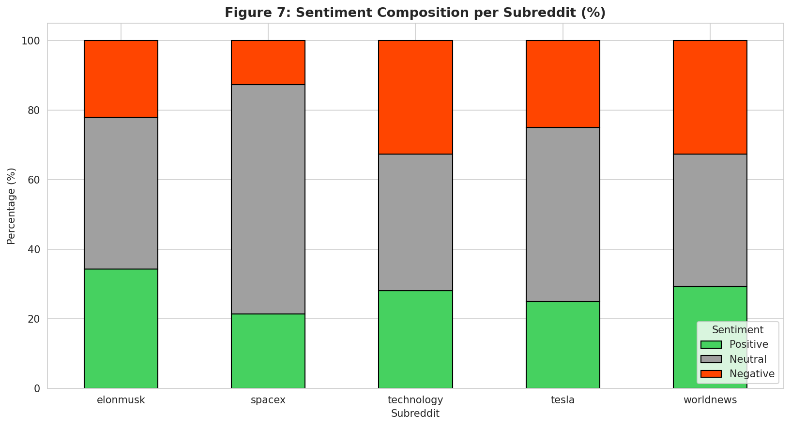
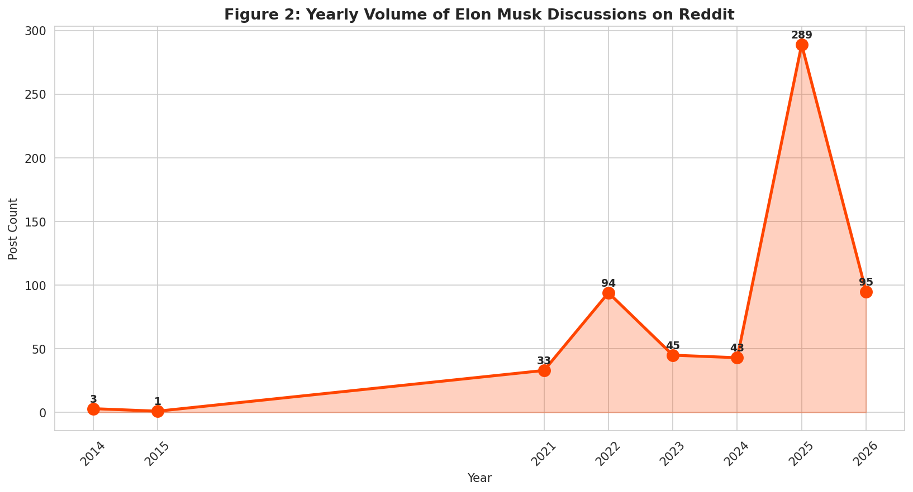
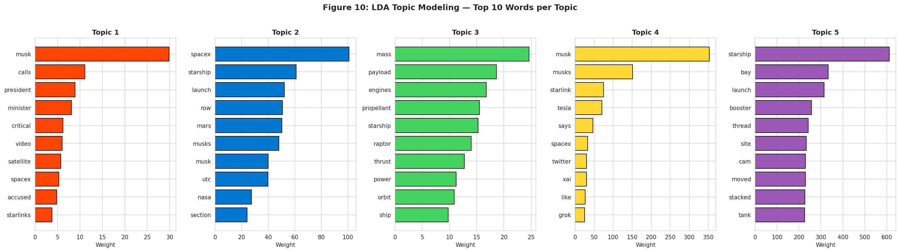

# Reddit Sentiment & Topic Analysis: Elon Musk

[](https://colab.research.google.com/github/OsmanAks22/Elon-Musk-Reddit-Analysis/blob/main/Elon_Musk_Reddit_Analysis.ipynb)

An NLP analysis of how five Reddit communities talk about Elon Musk. Posts are collected with the Reddit API (PRAW) and analysed with VADER sentiment, bigram frequencies and LDA topic modelling. The findings are written up as advice for a PR team.

> Individual coursework for **7BUIS025W Web & Social Media Analytics**, MSc Data Science & Analytics, University of Westminster (April 2026).

## Problem

A communications team wants to know how Reddit sees its client. Which communities are friendly or hostile, what people actually talk about, and how the conversation has changed over time.

## Data

- **Source:** the Reddit API through PRAW. The query "Elon Musk" was run in r/elonmusk, r/spacex, r/tesla, r/technology and r/worldnews, with up to 150 posts per subreddit, newest first.
- **Collected:** 604 raw posts. After removing duplicate IDs and posts whose combined text is under 10 characters, **603 posts** remain, spanning 14 May 2014 to 23 April 2026.
  - r/tesla returned only 4 posts, because its moderators restrict outside search; the other four subreddits each hit the 150-post cap.
  - 498 of the 603 posts have no body text (link or image posts).
- **Not included in this repository.** The raw posts contain Reddit usernames, so they are not published. Run the notebook with your own API credentials to collect a fresh sample. It will differ from the original, because Reddit search favours recent posts.

## Method

1. **Cleaning:** lower-casing, removal of URLs and non-letters, NLTK English stop-words, and dropping tokens of 2 characters or fewer. Title and body are combined into one `full_text` field.
2. **Exploration:** posts per subreddit, yearly volume, score distribution by subreddit, score against comments, word frequencies and a word cloud.
3. **Sentiment:** VADER compound score on post titles, labelled positive if ≥ 0.05, negative if ≤ −0.05, and neutral otherwise.
4. **Phrases:** the top 20 bigrams from `CountVectorizer(ngram_range=(2, 2))`.
5. **Topics:** LDA with 5 topics on a 1,000-term vocabulary (`min_df=5`, `max_df=0.7`). Four and six topics were also tried.

## Results

All numbers come from the original April 2026 run, as reported in the coursework report and its figures.

- **Sentiment is evenly split:** 170 posts positive (28.2%), 151 negative (25.0%) and 282 neutral (46.8%). The mean compound score is 0.013.
- **The communities differ sharply.**
  - r/spacex is the friendliest, with 12.6% of posts negative.
  - r/elonmusk is the most positive, with 34.5% of posts positive.
  - r/worldnews and r/technology are the most hostile, each with 32.7% of posts negative.
- **Volume jumped in 2025:** 289 posts, against 43 in 2024 and 94 in 2022, the previous peak.
- **Two separate conversations:** the five LDA topics fall into two groups. One is engineering (SpaceX launches, rocket hardware, Starbase). The other is political and platform news (political disputes, X, Starlink, Tesla).
- **Engagement is very skewed:** the mean post score is 3,291.94 against a median of 139, and the maximum is 78,015.

<p align="center">
  
</p>
<p align="center">
  
</p>
<p align="center">
  
</p>

All 11 figures from the original run are in [`figures/`](figures/).

## Limitations

- Reddit search returns recent and popular posts, not a random sample. The yearly trend therefore shows what search returns, not the true volume of discussion.
- r/tesla contributed only 4 posts, so the analysis says little about Tesla-specific sentiment.
- VADER scores headline-style titles; sarcasm and domain terms can mislead it.

## How to run

You need a Reddit "script" app (created at <https://www.reddit.com/prefs/apps>). The notebook reads its credentials from environment variables and stops with a clear message if they are missing.

**Locally (Python 3.12):**

```bash
python -m venv .venv
source .venv/bin/activate
pip install -r requirements.txt
export REDDIT_CLIENT_ID=...        # from your Reddit app
export REDDIT_CLIENT_SECRET=...
jupyter notebook Elon_Musk_Reddit_Analysis.ipynb
```

**Colab:** add `REDDIT_CLIENT_ID` and `REDDIT_CLIENT_SECRET` as Colab secrets (🔑 in the sidebar). Then run this before the notebook's second cell:

```python
import os
from google.colab import userdata
os.environ["REDDIT_CLIENT_ID"] = userdata.get("REDDIT_CLIENT_ID")
os.environ["REDDIT_CLIENT_SECRET"] = userdata.get("REDDIT_CLIENT_SECRET")
```

## Repository structure

```
Elon_Musk_Reddit_Analysis.ipynb   collection, cleaning, EDA, sentiment, bigrams, LDA
figures/                          the 11 figures from the original run
requirements.txt                  package versions used for the October 2026 check
```

## Changes since submission

- The notebook file was renamed to fix a typo (`Anlysis` → `Analysis`).
- Credentials are now read from environment variables instead of empty strings in the code.
- `plt.boxplot(labels=...)` was changed to `tick_labels=...`. Matplotlib renamed the argument in 3.9 and removed the old name in 3.11, so the Figure 3 cell crashed on current versions.
